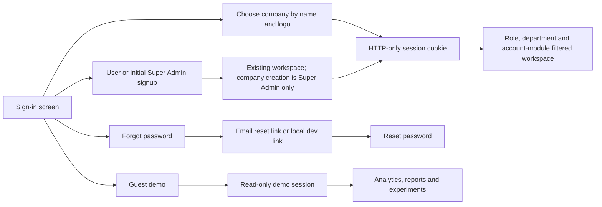
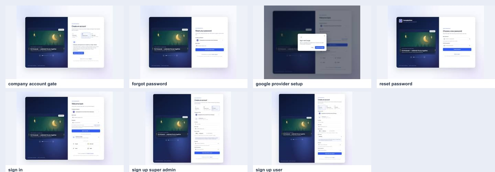
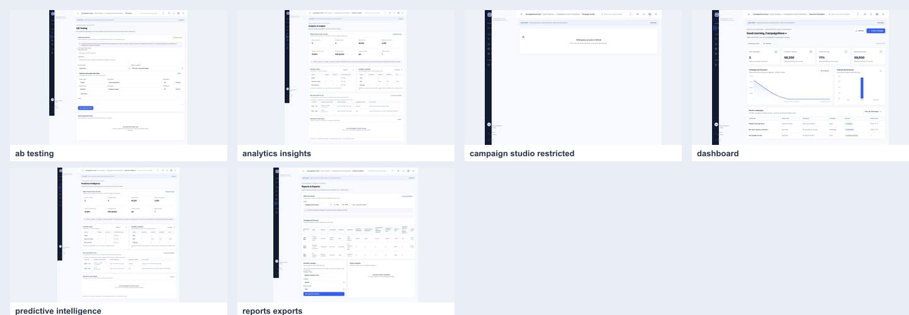
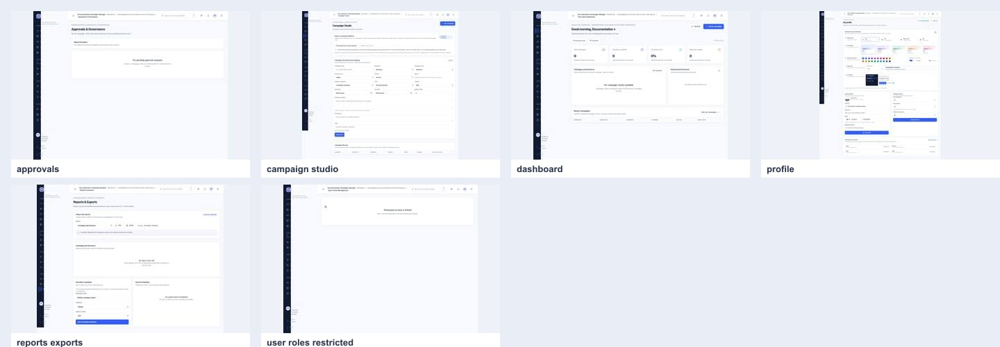
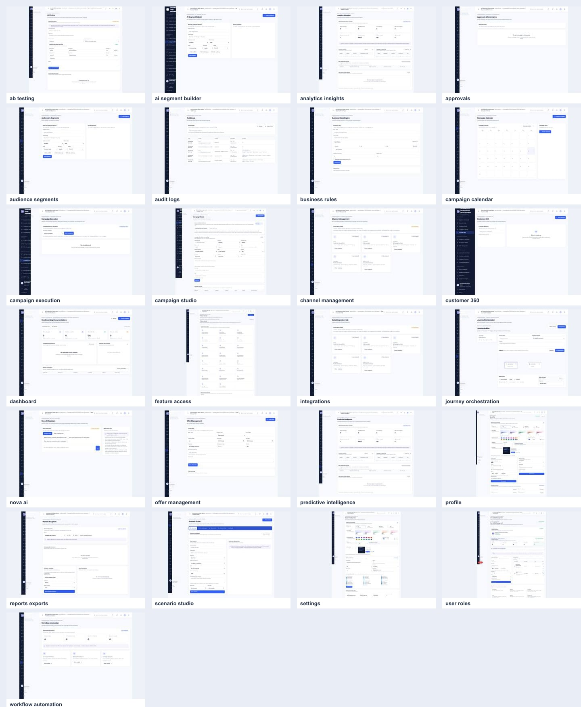
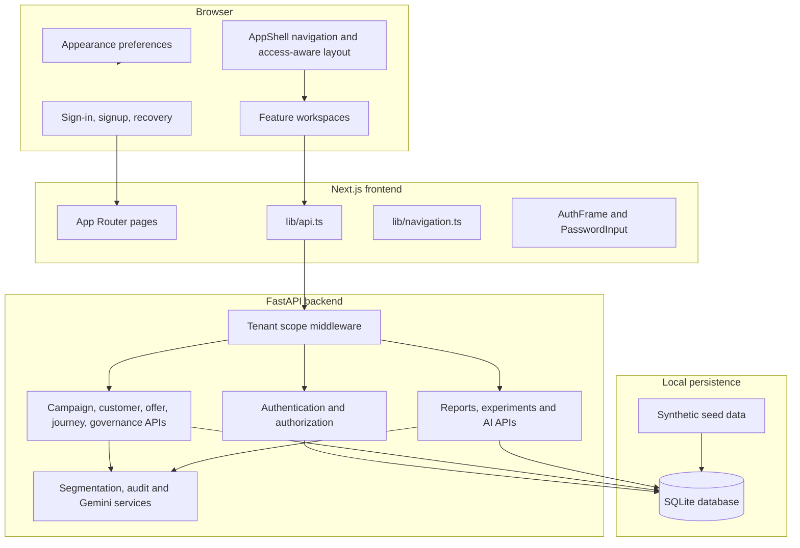

<div align="center">
  

  # CampaignNova

  **AI-powered enterprise campaign management and customer intelligence**

  A multi-workspace platform for planning customer campaigns, managing audiences and offers, orchestrating journeys, reviewing approvals, and learning from results.

  [Web app](http://localhost:3000) · [API docs](http://localhost:8000/docs) · [Health](http://localhost:8000/api/health)
</div>

---

## What CampaignNova does

CampaignNova brings the customer campaign lifecycle into one workspace. Teams can build campaigns, explore customer and segment records, manage offers and scenarios, configure journeys and business rules, simulate campaign execution, review approvals, and inspect reporting and predictive insights. Department and role access shape which work areas and actions each account can use.

The repository contains a Next.js frontend and FastAPI backend. During local development, the API stores synthetic data in SQLite. Channel execution is a simulation; it does not send customer messages. AI assistance uses local responses unless a Gemini key is configured.

## Start the app

### Docker Compose

Requirements: Docker and Docker Compose.

```bash
docker compose up --build
```

Open:

- Web workspace: <http://localhost:3000>
- API documentation: <http://localhost:8000/docs>
- Health endpoint: <http://localhost:8000/api/health>

### Run services directly

Requirements: Node.js 20+, Python 3.11+, and pip.

```bash
# Terminal 1
cd backend
python -m venv .venv
source .venv/bin/activate
pip install -r requirements.txt
uvicorn app.main:app --reload --port 8000

# Terminal 2
cd frontend
npm install
npm run dev
```

The frontend reads `NEXT_PUBLIC_API_URL` and defaults to `http://localhost:8000/api`. Copy `.env.example` to `.env` for local configuration. Do not commit `.env`, database files, or generated account credentials.

### Guest demo

Choose **Continue as a guest** on the sign-in page. This creates a short-lived, HTTP-only demo session scoped to the synthetic `campaignnova-demo` tenant. Guests have the `Viewer` role in `Data & Analytics`; they can inspect analytics, reports, predictive intelligence, and experiment planning. API writes are denied for this read-only role. Use **Exit demo** to revoke the session.

Demo access is available by default in development. In production it is disabled unless `CAMPAIGNNOVA_DEMO_MODE=true` is explicitly set. Only enable it when public read-only access to the seeded demo tenant is intended.

## Sign-in and account flows



- **Company login:** choose the workspace by company name/logo, then enter work email and password. Login errors do not disclose whether an email exists. Login attempts are rate-limited.
- **Account types:** User signup requests access to an existing company and stays pending until approved. Super Admin signup is only for an existing workspace with no accounts; production also requires the configured bootstrap token. A signed-in Super Admin creates new company workspaces and their first Super Admin from User & Role Management. There is no fixed default Super Admin password; account credentials are chosen during setup or provisioned by an administrator.
- **Company access:** a new company starts with core modules. Its Super Admin can add modules and upload company branding in System Configuration. Department Managers can allocate only company-enabled features to their own department. Employees can request any module; Super Admin approval enables it for the company and grants it to the requested department and account. The API enforces the same grants as the navigation. Super Admins can also set per-account module access; their own Settings and User & Role Management access is protected for recovery.
- **Remember this device:** opts into a longer-lived session cookie. Password saving is handled by the browser; when Chrome offers, save it to Google Password Manager. CampaignNova does not store clear-text passwords.
- **Password recovery:** configure SMTP to email reset links. In development without SMTP, the API returns a local reset link for developer use. Reset links expire and can only be used once.
- **Guest demo:** synthetic, read-only sample access with a visible demo banner. It has no password and creates no regular user account.
- **Social sign-in:** Google, Microsoft (personal and organization accounts), Yahoo, and Apple use the backend OpenID Connect authorization-code flow. The provider must be configured in the identity provider console and its callback URL must match exactly. Social login only signs into an existing active company account; it never creates users or companies. A verified provider email may match an existing account. Otherwise, sign in with the company password first and link the provider in Profile.
- **Sign out:** revokes the current server-side session and clears its cookie.

### Configure social sign-in

Copy the OAuth settings from `.env.example` into the backend environment, keep client secrets out of source control, and set `CAMPAIGNNOVA_OAUTH_SESSION_SECRET` to a long random value. The app is configured with these callback URLs:

- `http://localhost:8000/api/auth/oauth/google/callback`
- `http://localhost:8000/api/auth/oauth/microsoft/callback`
- `http://localhost:8000/api/auth/oauth/yahoo/callback`
- `https://your-public-domain/api/auth/oauth/apple/callback`

Register the matching callback URL with each provider. Google and Microsoft accept localhost callbacks for development. Apple requires a public HTTPS domain; its client secret is a developer-generated signing JWT. Apple sign-in remains unavailable until HTTPS and credentials are configured. Configure `CAMPAIGNNOVA_PUBLIC_API_URL` and `CAMPAIGNNOVA_PUBLIC_WEB_URL` to the public HTTPS URLs when deployed. OAuth provider buttons show as unavailable until their credentials and the state-signing secret are set.

### Screenshots: sign-in, sign-up, and recovery

These captures show the current screens against a temporary documentation workspace. They use synthetic data and contain no real account credentials. The Google setup-dialog screenshot records the unconfigured local OAuth state; provider sign-in only becomes available after valid provider credentials are set.



| Flow | Screenshot |
| --- | --- |
| Company sign-in, guest option, and social provider buttons | [Open sign-in](docs/screenshots/auth/sign-in.jpg) |
| Google provider setup dialog | [Open provider setup state](docs/screenshots/auth/google-provider-setup.jpg) |
| Request access to an existing company | [Open user sign-up](docs/screenshots/auth/sign-up-user.jpg) |
| Initial Super Admin setup | [Open Super Admin sign-up](docs/screenshots/auth/sign-up-super-admin.jpg) |
| Company creation restriction for public sign-up | [Open company account gate](docs/screenshots/auth/company-account-gate.jpg) |
| Forgot password | [Open recovery request](docs/screenshots/auth/forgot-password.jpg) |
| Choose a new password from a reset link | [Open reset-password form](docs/screenshots/auth/reset-password.jpg) |

### Screenshots: guest demo account

The guest account has read-only access to the synthetic demo tenant. It can view the dashboard, Analytics & Insights, Predictive Intelligence, Reports & Exports, and A/B Testing. The restricted Campaign Studio capture shows how the app handles a module outside the guest role.



| Guest view | Screenshot |
| --- | --- |
| Demo dashboard and read-only banner | [Open guest dashboard](docs/screenshots/guest/dashboard.jpg) |
| Analytics & Insights | [Open guest analytics](docs/screenshots/guest/analytics-insights.jpg) |
| Predictive Intelligence | [Open guest predictive insights](docs/screenshots/guest/predictive-intelligence.jpg) |
| Reports & Exports | [Open guest reports](docs/screenshots/guest/reports-exports.jpg) |
| A/B Testing | [Open guest experiments](docs/screenshots/guest/ab-testing.jpg) |
| Role-restricted Campaign Studio | [Open restricted-module state](docs/screenshots/guest/campaign-studio-restricted.jpg) |

### Screenshots: regular Campaign Manager account

This active user account was created and approved inside the temporary documentation workspace. It demonstrates department-scoped navigation and the administrator-only account-management restriction.



| Campaign Manager view | Screenshot |
| --- | --- |
| Workspace dashboard | [Open user dashboard](docs/screenshots/campaign-manager/dashboard.jpg) |
| Campaign creation and lifecycle | [Open Campaign Studio](docs/screenshots/campaign-manager/campaign-studio.jpg) |
| Approval queue | [Open Approvals & Governance](docs/screenshots/campaign-manager/approvals.jpg) |
| Reports | [Open Reports & Exports](docs/screenshots/campaign-manager/reports-exports.jpg) |
| Administrator-only account directory | [Open restricted User & Role Management](docs/screenshots/campaign-manager/user-roles-restricted.jpg) |
| User profile and session controls | [Open profile](docs/screenshots/campaign-manager/profile.jpg) |

### Screenshots: Super Admin and module workspaces

The documentation Super Admin has every module enabled in the temporary workspace. Module screenshots are listed in the [frontend screen and component guide](#feature-workspaces), alongside each module's purpose. These pages demonstrate the UI and synthetic sample state; they do not imply that external delivery or OAuth providers are connected.



| Super Admin view | Screenshot |
| --- | --- |
| Workspace dashboard | [Open Super Admin dashboard](docs/screenshots/super-admin/dashboard.jpg) |
| Team directory, role controls, and module grants | [Open User & Role Management](docs/screenshots/super-admin/user-roles.jpg) |
| Workspace configuration and appearance | [Open System Configuration](docs/screenshots/super-admin/settings.jpg) |
| Module and account profile | [Open Super Admin profile](docs/screenshots/super-admin/profile.jpg) |

## Architecture



### Request and access path

The browser calls the FastAPI `/api` routes through `frontend/lib/api.ts` using credentialed requests. Authentication sets an HTTP-only session cookie. Backend middleware resolves the session tenant for each request; route dependencies then enforce role, department, module, and read-only rules. Domain APIs read and write through the tenant-scoped database helpers. Frontend navigation filters modules for usability, while backend authorization remains the security boundary.

### Top-level folders

| Path | Purpose |
| --- | --- |
| `frontend/app/` | Next.js routes, root layout, global styling, and app icon. |
| `frontend/components/` | Shared application shell, password control, and Nova assistant dock. |
| `frontend/features/` | Module-specific screens, forms, workspaces, and controls. |
| `frontend/lib/` | API client, module navigation and access helpers, and saved appearance preferences. |
| `backend/app/routers/` | HTTP endpoints grouped by domain. |
| `backend/app/services/` | Reusable segmentation, audit, and AI provider logic. |
| `backend/app/database.py` | Tenant-scoped SQLite record access. |
| `backend/app/store.py` | Local database initialization and synthetic seed data. |
| `docs/` | Architecture, auth, phase contracts, roadmap, and team workstreams. |

## Frontend screen and component guide

### Shared application components

| Component | What it does |
| --- | --- |
| `frontend/features/auth/AuthFrame.tsx` | Branded split-screen auth layout with responsive campaign illustration, logo, workspace messaging, and mobile layout. |
| `frontend/components/AppShell.tsx` | Loads the session and appearance, filters navigation, provides workspace search, profile/settings links, notifications, assistant launch, and guest-demo banner. |
| `frontend/components/PasswordInput.tsx` | Shared password input with show/hide control. |
| `frontend/components/NovaChatDock.tsx` | Floating assistant panel that sends a prompt to the API and shows a response. Avoid submitting personal customer data. |
| `frontend/features/auth/ProfileWorkspace.tsx` | Profile image/contact details, password change, saved appearance settings, and sign out. |
| `frontend/features/governance/AppearancePreferences.tsx` | Light, dark, grey, and high-contrast modes; coordinated palettes, custom colors, and font choices. |

### Feature workspaces

| Screen/component | What it does | Screenshot |
| --- | --- | --- |
| `frontend/app/page.tsx` | Landing dashboard with workspace metrics, activity, and module entry points. | [Dashboard](docs/screenshots/super-admin/dashboard.jpg) |
| `frontend/features/scenarios/ScenarioWorkspace.tsx` | Compare campaign scenarios and inspect planning simulations. | [Scenario Studio](docs/screenshots/super-admin/scenario-studio.jpg) |
| `frontend/features/campaigns/CampaignStudio.tsx` | Create and maintain campaign plans and their audience, channel, schedule, and offer settings. | [Campaign Studio](docs/screenshots/super-admin/campaign-studio.jpg) |
| `frontend/features/campaigns/CampaignCalendar.tsx` | Review scheduled campaign activity in a calendar view. | [Campaign Calendar](docs/screenshots/super-admin/campaign-calendar.jpg) |
| `frontend/features/customers/Customer360.tsx` | Search customer profiles and inspect lifecycle, value, consent, and interaction context. Uses synthetic development records. | [Customer 360](docs/screenshots/super-admin/customer-360.jpg) |
| `frontend/features/audiences/SegmentManager.tsx` | Create and review audience segments and their estimated reach. | [Audience & Segments](docs/screenshots/super-admin/audience-segments.jpg) |
| `frontend/features/audiences/SegmentManager.tsx` | Preview audience estimates from validated rules against the local synthetic sample. | [AI Segment Builder](docs/screenshots/super-admin/ai-segment-builder.jpg) |
| `frontend/features/offers/OfferCatalog.tsx` | Manage offer catalog records and campaign eligibility details. | [Offer Management](docs/screenshots/super-admin/offer-management.jpg) |
| `frontend/features/journeys/JourneyBuilder.tsx` | Configure customer journey steps and orchestration paths. | [Journey Orchestration](docs/screenshots/super-admin/journey-orchestration.jpg) |
| `frontend/features/orchestration/AutomationCenter.tsx` | Manage workflow automation and operational triggers. | [Workflow Automation](docs/screenshots/super-admin/workflow-automation.jpg) |
| `frontend/features/execution/ExecutionConsole.tsx` | Run and inspect simulated campaign execution outcomes; no live delivery provider is called. | [Campaign Execution](docs/screenshots/super-admin/campaign-execution.jpg) |
| `frontend/features/governance/IntegrationHub.tsx` | Review channel adapter requirements and connection state. External channels remain unconnected. | [Channel Management](docs/screenshots/super-admin/channel-management.jpg) |
| `frontend/features/intelligence/NovaAssistant.tsx` | Ask about synthetic workspace data or draft campaign copy using Gemini when configured, otherwise local templates. | [Nova AI Assistant](docs/screenshots/super-admin/nova-ai.jpg) |
| `frontend/features/intelligence/IntelligenceWorkspace.tsx` | Explore explainable, rule-based offer cues and observed aggregates. | [Predictive Intelligence](docs/screenshots/super-admin/predictive-intelligence.jpg) |
| `frontend/features/intelligence/ExperimentWorkspace.tsx` | Plan a test hypothesis and preview consent-filtered sample allocation. | [A/B Testing](docs/screenshots/super-admin/ab-testing.jpg) |
| `frontend/features/intelligence/IntelligenceWorkspace.tsx` | Explore observed aggregates, descriptive cohorts, and customer/campaign signals. | [Analytics & Insights](docs/screenshots/super-admin/analytics-insights.jpg) |
| `frontend/features/reports/ReportsWorkspace.tsx` | Review and export reports from observed campaign and simulation data. | [Reports & Exports](docs/screenshots/super-admin/reports-exports.jpg) |
| `frontend/features/governance/IntegrationHub.tsx` | Review integration connector requirements and connection status. | [Data Integration Hub](docs/screenshots/super-admin/integrations.jpg) |
| `frontend/features/rules/BusinessRuleManager.tsx` | Define eligibility rules, frequency caps, and quiet-hour suppression. | [Business Rules Engine](docs/screenshots/super-admin/business-rules.jpg) |
| `frontend/features/governance/ApprovalsWorkspace.tsx` | Review pending changes and submit approval decisions according to role. | [Approvals & Governance](docs/screenshots/super-admin/approvals.jpg) |
| `frontend/features/governance/FeatureAccessWorkspace.tsx` | Review department feature requests and company module availability. | [Feature Access](docs/screenshots/super-admin/feature-access.jpg) |
| `frontend/features/governance/AdministrationWorkspace.tsx` | Manage team accounts, roles, departments, account approval, and per-user module access. | [User & Role Management](docs/screenshots/super-admin/user-roles.jpg) |
| `frontend/features/governance/AuditLogWorkspace.tsx` | Inspect the workspace audit trail. | [Audit Logs](docs/screenshots/super-admin/audit-logs.jpg) |
| `frontend/features/governance/SettingsWorkspace.tsx` | Configure workspace preferences, modules, branding, and appearance. | [System Configuration](docs/screenshots/super-admin/settings.jpg) |
| `frontend/features/auth/ProfileWorkspace.tsx` | Update profile details, change a password, adjust appearance, and sign out. | [Account profile](docs/screenshots/super-admin/profile.jpg) |

Authentication pages are `frontend/app/login/page.tsx`, `signup/page.tsx`, `forgot-password/page.tsx`, and `reset-password/page.tsx`. Dynamic module paths resolve through `frontend/app/[...slug]/page.tsx`.

## Backend API guide

All endpoints are under `/api`. OpenAPI docs are available at `/docs` when the backend runs.

| Router | Main responsibility |
| --- | --- |
| `authentication.py` | Signup, login, guest demo, logout, profile, password recovery/change, and role/department checks. |
| `system.py` | Health and public system metadata. |
| `dashboard.py` | Dashboard metrics and activity. |
| `campaigns.py` | Campaign records and calendars. |
| `customers.py` | Customer profiles, search, and consent. |
| `audiences.py` | Audience segment records and reach estimates. |
| `offers.py` | Offer catalog APIs. |
| `scenarios.py` | Campaign scenario records and simulations. |
| `journeys.py` | Journey definitions and steps. |
| `business_rules.py` | Business rules. |
| `execution.py` | Campaign execution simulation and run history. |
| `approvals.py` | Approval queues and decisions. |
| `administration.py` | Users, roles, account approval, and workspace administration. |
| `integrations.py` | Integration and channel configuration records. |
| `intelligence.py` | Analytics and predictive insight APIs. |
| `experiments.py` | A/B test planning and results. |
| `reports.py` | Report data and export APIs. |
| `workspaces.py` | Workspace-level data and module status. |
| `ai.py` | Nova assistant API. |

Shared services live in `backend/app/services/`: `segmentation.py` builds audience analysis, `audit.py` records audit events, and `gemini.py` selects configured Gemini or local fallback responses. Pydantic request/response models are in `backend/app/schemas.py`.

## Configuration and operations

| Variable | Purpose |
| --- | --- |
| `CAMPAIGNNOVA_ENV` | `development` or `production`; production requires an initial bootstrap token and disables guest mode by default. |
| `CAMPAIGNNOVA_DB_PATH` | SQLite database path. Use a persistent mounted volume when running outside development. |
| `NEXT_PUBLIC_API_URL` | Frontend API base, normally `http://localhost:8000/api`. |
| `CAMPAIGNNOVA_PUBLIC_WEB_URL` | Public frontend base URL used to construct account recovery links. |
| `CAMPAIGNNOVA_SECURE_COOKIES` | Set `true` when the app is served over HTTPS. |
| `CAMPAIGNNOVA_BOOTSTRAP_TOKEN` | One-time environment secret required for first account creation in production. |
| `CAMPAIGNNOVA_DEMO_MODE` | Set `true` to intentionally allow public read-only demo sessions in production. |
| `CAMPAIGNNOVA_WEB_ORIGINS` | Comma-separated allowed browser origins for CORS and state-changing request checks. |
| `SMTP_HOST`, `SMTP_PORT`, `SMTP_USER`, `SMTP_PASSWORD`, `SMTP_FROM_EMAIL`, `SMTP_STARTTLS` | Outbound email settings for password recovery. |
| `GEMINI_API_KEY` | Optional Gemini API key for AI responses. Without it, local fallback responses are used. |

Keep production secrets in a secret manager or environment configuration. Never put real subscriber data, passwords, or API keys in the repository. `.gitignore` excludes local environment files, generated account credentials, SQLite data, build output, and dependencies.

## Current scope and production setup

- Development seed records and guest demo records are synthetic. Audience reach and predictive values are illustrative estimates, not production recommendations.
- Execution, delivery channels, and integrations are simulation/configuration experiences until real provider adapters are built and reviewed.
- AI replies can use a configured Gemini provider or local fallback. Do not enter subscriber personal information in prompts.
- Social sign-in for Google, Microsoft, Yahoo, and Apple is implemented, but remains unavailable until the matching provider credentials and OAuth session secret are configured. See [Configure social sign-in](#configure-social-sign-in) for callback URLs and environment variables.
- Before production use, configure HTTPS, secure cookies, SMTP, durable database backups, logging/monitoring, provider credentials, retention controls, and a reviewed deployment. Confirm tenant isolation and authorization policies for your deployment environment.

## Project documentation

- `docs/ARCHITECTURE.md` — architecture and service boundaries.
- `docs/AUTHENTICATION.md` — identity, sessions, recovery, and authorization.
- `docs/ROADMAP.md` — four phase product roadmap.
- `docs/PHASE_2_MODULE_CONTRACTS.md`, `PHASE_3_MODULE_CONTRACTS.md`, `PHASE_4_MODULE_CONTRACTS.md` — phase module behavior and contracts.
- `docs/TEAM_WORKSTREAMS.md` — nine developer workstreams and ownership areas.
- `backend/README.md`, `frontend/README.md` — service-specific setup notes.
