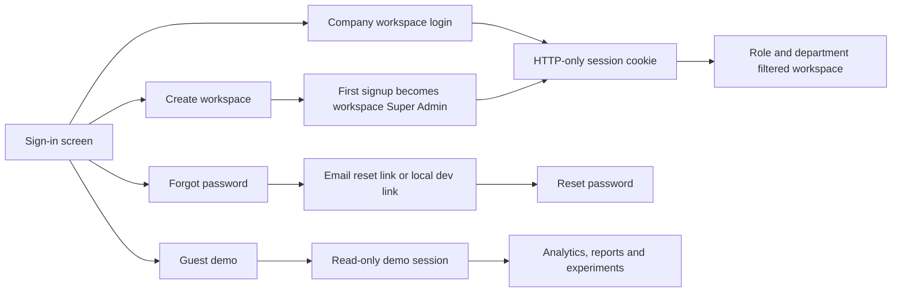
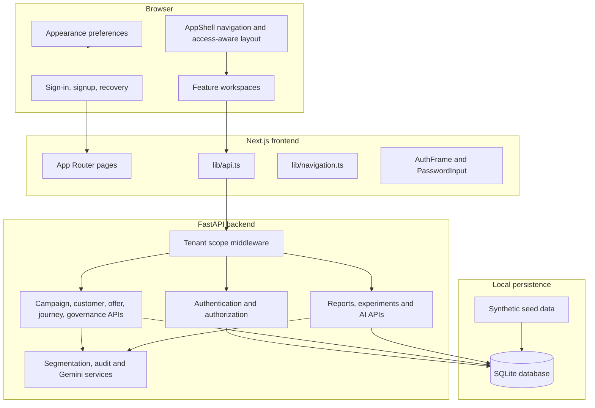

<div align="center">
  

  # CampaignNova

  **AI-powered enterprise campaign management and customer intelligence**

  A multi-workspace platform for planning customer campaigns, managing audiences and offers, orchestrating journeys, reviewing approvals, and learning from results.

  [Web app](http://localhost:3000) · [API docs](http://localhost:8000/docs) · [Health](http://localhost:8000/api/health)
</div>

---

## What CampaignNova does

CampaignNova brings the customer campaign lifecycle into one workspace. Teams can build campaigns, explore customer and segment records, manage offers and scenarios, configure journeys and business rules, simulate campaign execution, review approvals, and inspect reporting and predictive insights. Department and role access shape which work areas and actions each account can use.

The repository contains a Next.js frontend and FastAPI backend. During local development, the API stores synthetic data in SQLite. Channel execution is a simulation; it does not send customer messages. AI assistance uses local responses unless a Gemini key is configured.

## Start the app

### Docker Compose

Requirements: Docker and Docker Compose.

```bash
docker compose up --build
```

Open:

- Web workspace: <http://localhost:3000>
- API documentation: <http://localhost:8000/docs>
- Health endpoint: <http://localhost:8000/api/health>

### Run services directly

Requirements: Node.js 20+, Python 3.11+, and pip.

```bash
# Terminal 1
cd backend
python -m venv .venv
source .venv/bin/activate
pip install -r requirements.txt
uvicorn app.main:app --reload --port 8000

# Terminal 2
cd frontend
npm install
npm run dev
```

The frontend reads `NEXT_PUBLIC_API_URL` and defaults to `http://localhost:8000/api`. Copy `.env.example` to `.env` for local configuration. Do not commit `.env`, database files, or generated account credentials.

### Guest demo

Choose **Continue as a guest** on the sign-in page. This creates a short-lived, HTTP-only demo session scoped to the synthetic `campaignnova-demo` tenant. Guests have the `Viewer` role in `Data & Analytics`; they can inspect analytics, reports, predictive intelligence, and experiment planning. API writes are denied for this read-only role. Use **Exit demo** to revoke the session.

Demo access is available by default in development. In production it is disabled unless `CAMPAIGNNOVA_DEMO_MODE=true` is explicitly set. Only enable it when public read-only access to the seeded demo tenant is intended.

## Sign-in and account flows



- **Company login:** enter the workspace code, work email, and password. Login errors do not disclose whether an email exists. Login attempts are rate-limited.
- **Create account:** the first approved account in a new company workspace is its Super Admin. Later registrations are pending approval. The workspace code is derived from the company name.
- **Password recovery:** configure SMTP to email reset links. In development without SMTP, the API returns a local reset link for developer use. Reset links expire and can only be used once.
- **Guest demo:** synthetic, read-only sample access with a visible demo banner. It has no password and creates no regular user account.
- **Google login:** the sign-in screen shows the Google option as unavailable because this repository has no Google OAuth client, callback, or verification configuration. It does not simulate a successful Google login. Configure and implement an identity provider before enabling production Google sign-in.
- **Sign out:** revokes the current server-side session and clears its cookie.

## Architecture



### Request and access path

The browser calls the FastAPI `/api` routes through `frontend/lib/api.ts` using credentialed requests. Authentication sets an HTTP-only session cookie. Backend middleware resolves the session tenant for each request; route dependencies then enforce role, department, module, and read-only rules. Domain APIs read and write through the tenant-scoped database helpers. Frontend navigation filters modules for usability, while backend authorization remains the security boundary.

### Top-level folders

| Path | Purpose |
| --- | --- |
| `frontend/app/` | Next.js routes, root layout, global styling, and app icon. |
| `frontend/components/` | Shared application shell, password control, and Nova assistant dock. |
| `frontend/features/` | Module-specific screens, forms, workspaces, and controls. |
| `frontend/lib/` | API client, module navigation and access helpers, and saved appearance preferences. |
| `backend/app/routers/` | HTTP endpoints grouped by domain. |
| `backend/app/services/` | Reusable segmentation, audit, and AI provider logic. |
| `backend/app/database.py` | Tenant-scoped SQLite record access. |
| `backend/app/store.py` | Local database initialization and synthetic seed data. |
| `docs/` | Architecture, auth, phase contracts, roadmap, and team workstreams. |

## Frontend screen and component guide

### Shared application components

| Component | What it does |
| --- | --- |
| `frontend/features/auth/AuthFrame.tsx` | Branded split-screen auth layout with responsive campaign illustration, logo, workspace messaging, and mobile layout. |
| `frontend/components/AppShell.tsx` | Loads the session and appearance, filters navigation, provides workspace search, profile/settings links, notifications, assistant launch, and guest-demo banner. |
| `frontend/components/PasswordInput.tsx` | Shared password input with show/hide control. |
| `frontend/components/NovaChatDock.tsx` | Floating assistant panel that sends a prompt to the API and shows a response. Avoid submitting personal customer data. |
| `frontend/features/auth/ProfileWorkspace.tsx` | Profile image/contact details, password change, saved appearance settings, and sign out. |
| `frontend/features/governance/AppearancePreferences.tsx` | Light, dark, grey, and high-contrast modes; coordinated palettes, custom colors, and font choices. |

### Feature workspaces

| Screen/component | What it does |
| --- | --- |
| `frontend/app/page.tsx` | Landing dashboard with workspace metrics, activity, and module entry points. |
| `frontend/features/campaigns/CampaignStudio.tsx` | Create and maintain campaign plans and their audience, channel, schedule, and offer settings. |
| `frontend/features/campaigns/CampaignCalendar.tsx` | Review scheduled campaign activity in a calendar view. |
| `frontend/features/customers/Customer360.tsx` | Search customer profiles and inspect lifecycle, value, consent, and interaction context. Uses synthetic development records. |
| `frontend/features/audiences/SegmentManager.tsx` | Create and review audience segments and their estimated reach. |
| `frontend/features/offers/OfferCatalog.tsx` | Manage offer catalog records and campaign eligibility details. |
| `frontend/features/scenarios/ScenarioWorkspace.tsx` | Compare campaign scenarios and inspect planning simulations. |
| `frontend/features/journeys/JourneyBuilder.tsx` | Configure customer journey steps and orchestration paths. |
| `frontend/features/orchestration/AutomationCenter.tsx` | Manage workflow automation and operational triggers. |
| `frontend/features/rules/BusinessRuleManager.tsx` | Define business rules and review rule status. |
| `frontend/features/execution/ExecutionConsole.tsx` | Run and inspect simulated campaign execution outcomes; no live delivery provider is called. |
| `frontend/features/governance/ApprovalsWorkspace.tsx` | Review pending changes and submit approval decisions according to role. |
| `frontend/features/governance/AuditLogWorkspace.tsx` | Inspect recorded workspace audit events. |
| `frontend/features/governance/AdministrationWorkspace.tsx` | Manage team accounts, roles, departments, and account approvals for administrators. |
| `frontend/features/governance/IntegrationHub.tsx` | Review integration/channel configuration placeholders and connection status. |
| `frontend/features/governance/SettingsWorkspace.tsx` | Workspace settings and appearance controls. |
| `frontend/features/intelligence/IntelligenceWorkspace.tsx` | Inspect descriptive and predictive customer/campaign insights. |
| `frontend/features/intelligence/ExperimentWorkspace.tsx` | Plan and compare A/B experiment variants and results. |
| `frontend/features/intelligence/NovaAssistant.tsx` | Full AI assistance workspace. |
| `frontend/features/reports/ReportsWorkspace.tsx` | Review and export reports. |

Authentication pages are `frontend/app/login/page.tsx`, `signup/page.tsx`, `forgot-password/page.tsx`, and `reset-password/page.tsx`. Dynamic module paths resolve through `frontend/app/[...slug]/page.tsx`.

## Backend API guide

All endpoints are under `/api`. OpenAPI docs are available at `/docs` when the backend runs.

| Router | Main responsibility |
| --- | --- |
| `authentication.py` | Signup, login, guest demo, logout, profile, password recovery/change, and role/department checks. |
| `system.py` | Health and public system metadata. |
| `dashboard.py` | Dashboard metrics and activity. |
| `campaigns.py` | Campaign records and calendars. |
| `customers.py` | Customer profiles, search, and consent. |
| `audiences.py` | Audience segment records and reach estimates. |
| `offers.py` | Offer catalog APIs. |
| `scenarios.py` | Campaign scenario records and simulations. |
| `journeys.py` | Journey definitions and steps. |
| `business_rules.py` | Business rules. |
| `execution.py` | Campaign execution simulation and run history. |
| `approvals.py` | Approval queues and decisions. |
| `administration.py` | Users, roles, account approval, and workspace administration. |
| `integrations.py` | Integration and channel configuration records. |
| `intelligence.py` | Analytics and predictive insight APIs. |
| `experiments.py` | A/B test planning and results. |
| `reports.py` | Report data and export APIs. |
| `workspaces.py` | Workspace-level data and module status. |
| `ai.py` | Nova assistant API. |

Shared services live in `backend/app/services/`: `segmentation.py` builds audience analysis, `audit.py` records audit events, and `gemini.py` selects configured Gemini or local fallback responses. Pydantic request/response models are in `backend/app/schemas.py`.

## Configuration and operations

| Variable | Purpose |
| --- | --- |
| `CAMPAIGNNOVA_ENV` | `development` or `production`; production requires an initial bootstrap token and disables guest mode by default. |
| `CAMPAIGNNOVA_DB_PATH` | SQLite database path. Use a persistent mounted volume when running outside development. |
| `NEXT_PUBLIC_API_URL` | Frontend API base, normally `http://localhost:8000/api`. |
| `CAMPAIGNNOVA_PUBLIC_WEB_URL` | Public frontend base URL used to construct account recovery links. |
| `CAMPAIGNNOVA_SECURE_COOKIES` | Set `true` when the app is served over HTTPS. |
| `CAMPAIGNNOVA_BOOTSTRAP_TOKEN` | One-time environment secret required for first account creation in production. |
| `CAMPAIGNNOVA_DEMO_MODE` | Set `true` to intentionally allow public read-only demo sessions in production. |
| `CAMPAIGNNOVA_WEB_ORIGINS` | Comma-separated allowed browser origins for CORS and state-changing request checks. |
| `SMTP_HOST`, `SMTP_PORT`, `SMTP_USER`, `SMTP_PASSWORD`, `SMTP_FROM_EMAIL`, `SMTP_STARTTLS` | Outbound email settings for password recovery. |
| `GEMINI_API_KEY` | Optional Gemini API key for AI responses. Without it, local fallback responses are used. |

Keep production secrets in a secret manager or environment configuration. Never put real subscriber data, passwords, or API keys in the repository. `.gitignore` excludes local environment files, generated account credentials, SQLite data, build output, and dependencies.

## Current scope and production setup

- Development seed records and guest demo records are synthetic. Audience reach and predictive values are illustrative estimates, not production recommendations.
- Execution, delivery channels, and integrations are simulation/configuration experiences until real provider adapters are built and reviewed.
- AI replies can use a configured Gemini provider or local fallback. Do not enter subscriber personal information in prompts.
- Google OAuth is not wired. The sign-in screen explicitly marks Google as unavailable; adding an OAuth client, callback, verified identity flow, and workspace account mapping is required before offering it.
- Before production use, configure HTTPS, secure cookies, SMTP, durable database backups, logging/monitoring, provider credentials, retention controls, and a reviewed deployment. Confirm tenant isolation and authorization policies for your deployment environment.

## Project documentation

- `docs/ARCHITECTURE.md` — architecture and service boundaries.
- `docs/AUTHENTICATION.md` — identity, sessions, recovery, and authorization.
- `docs/ROADMAP.md` — four phase product roadmap.
- `docs/PHASE_2_MODULE_CONTRACTS.md`, `PHASE_3_MODULE_CONTRACTS.md`, `PHASE_4_MODULE_CONTRACTS.md` — phase module behavior and contracts.
- `docs/TEAM_WORKSTREAMS.md` — nine developer workstreams and ownership areas.
- `backend/README.md`, `frontend/README.md` — service-specific setup notes.
